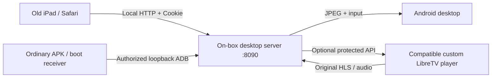

<div align="center">

# M13 iPad Remote

**让旧 iPad 成为电视盒子的触屏屏幕，日常连接无需电脑。**  
**Give an old iPad a second life as a touch display for an Android TV box.**


[中文](#中文说明) · [English](#english) · [Download / 下载](../../releases) · [验证范围 / Validation](docs/validation.md)

</div>

---

## 中文说明

把仍能开机的 iPad mini 1（A1432）接入同一局域网，在旧版 Safari 中查看并触控天猫魔盒 M13 桌面。菜单、返回、首页、方向键都在网页里；进入适配的 LibreTV 播放器时，自动接入影片原始音画并尝试跟随电视进度。电脑用于初次安装或恢复，日常服务在盒子里运行。

这是针对一台具体旧设备逐步验证的实验项目，**不是任意 Android 盒子或任意视频 App 的通用投屏方案**。

UI3 新增可选的独立「iPad 面板守护」，用于面板被停、服务退出及更新后的自动恢复。需要另外安装同签名守护 APK，详见 [自动恢复](docs/automatic-recovery.md)。多项目调试请先读 [连接协调](docs/debugging-connections.md)。

### 能力与边界

| 功能 | 当前情况 |
|---|---|
| 自动恢复（UI3） | 独立同签名守护、开机启动与更新恢复；具体验收和边界见自动恢复说明 |
| 触屏桌面 | JPEG 桌面、点击、滑动、固定遥控按键，适配横竖屏 |
| 长期登录 | 私有随机密钥 + HttpOnly 持久 Cookie；应用/服务重启后沿用凭证，打开页面自动续期 |
| LibreTV 音画 | 依赖定制轻桌面的原生播放器接口与本机媒体代理；支持时自动切换，无需找模式按钮 |
| 暂停、继续、快进 | 已在配套 2.22-sync1 播放器与真实 iPad 上验收；依赖对应控制补丁 |
| 720p30 镜像 | 已验证更流畅的动态画面；该镜像没有系统声音 |
| 哔哩哔哩、其他 App | 没有实现通用音画/同步；保留原界面的哔哩哔哩路径未跑通 |
| 60 fps / 零延迟 | 没有实现；网络进度校准不等于逐帧同步 |

### 安装与连接

1. 从 [Releases](../../releases) 下载 `M13-iPad-Remote-0.8-ui3.apk`，仅在你自己有权管理的兼容盒子上安装。
2. 盒子需启用可用的网络 ADB 调试，本项目在 M13 的 Android 5.1 / API 22 上验证。本机启动器连接 `127.0.0.1:5555`；不是只装 APK 就能在所有盒子上工作。
3. 打开电视上的「iPad 桌面连接」。如弹出本机调试授权，勾选始终允许并确认。网页地址和每台设备生成的密码显示在电视上。
4. iPad 和盒子接入同一可信家庭网络，Safari 打开电视显示的 `http://盒子IP:8090/`，输入密码。可添加到主屏幕。
5. 首次登录后保存长期凭证；不要使用无痕窗口。UI3 已验证断电重启后原凭证仍有效。清除网站数据、改变 IP、更换密码或清除应用数据后需要重新登录。
6. 如需自动守护，再安装同一发布页的 `M13-iPad-Keeper-0.1.apk`，并在电视打开一次「iPad 面板守护」。两个 APK 必须使用相同签名；详见 [自动恢复](docs/automatic-recovery.md)。

已启用网络 ADB 的用户也可在电脑安装：

```sh
adb connect <BOX_IP>:5555
adb -s <BOX_IP>:5555 install -r M13-iPad-Remote-0.8-ui3.apk
adb -s <BOX_IP>:5555 shell am start -n local.m13.ipadremote/.MainActivity
adb disconnect <BOX_IP>:5555
```

这台 M13 的电脑调试与本机启动器可能争用同一连接。**安装后断开电脑 ADB，再等盒子自行启动服务。** 实测日常连接不需要电脑代理，当前版本以网页左上角 `0.8 · UI3` 为准。

影片适配不是安装标准 LibreTV 网页即可启用。请先阅读 [播放器接口与补丁](docs/player-integration.md)，不要用旧播放器安装包覆盖自己的新版本。

### 构建与测试

需要 Python 3、JDK、Android SDK 平台 `android-22` 及包含 aapt / D8 / zipalign / apksigner 的 Build Tools（验证使用 35.0.0）。不需要 Gradle、外部 Python 包或网页框架。

```sh
python build.py --sdk /path/to/android-sdk --java-home /path/to/jdk --unsigned
python scripts/test_auth.py --java-home /path/to/jdk
```

未签名产物不能直接安装。使用你自己的签名密钥生成可安装 APK：

```sh
# Set M13_KEYSTORE_PASSWORD in your local environment first; do not commit it.
python build.py --sdk /path/to/android-sdk --java-home /path/to/jdk --keystore .local/remote.jks
```

密钥不存在时会在指定位置新建。保留同一密钥才能覆盖更新；改用其他签名通常需要先卸载，卸载会清除登录设置和本机授权。仓库不包含本机签名密钥。详细说明见 [构建与恢复](docs/build-and-recovery.md)。

## English

M13 iPad Remote reuses a first-generation iPad mini (A1432, iOS 9.3.5) as a browser-based touch display for a Tmall MagicBox M13. The Android box hosts the server and the ES5 web UI. A computer is needed for installation or recovery, **not for everyday use**.

UI3 adds an optional, separately installed, same-signed keeper for panel/service recovery. See [automatic recovery](docs/automatic-recovery.md) and [debugging coordination](docs/debugging-connections.md).

### What works

- Touch desktop with JPEG frames, taps, swipes, fixed navigation buttons and landscape/portrait layouts.
- Remembered login using an app-private random secret and an HttpOnly persistent cookie, renewed when the status page opens.
- Automatic original-media video/audio handoff for an integrated custom LibreTV player. Play/pause/seek synchronization requires its matching control API.
- Optional 720p30 video mirroring, without system audio.

This is a device-specific experiment, not a universal Android streaming service. Only M13 / Android API 22 and the stated iPad were tested. Other apps, original-interface Bilibili streaming/audio, 60 fps and frame-exact synchronization are not supported. Historical movie/sync acceptance used the customized 2.22-sync1 launcher; later launcher versions were not revalidated for that integration.

### Quick start

Download the APK from [Releases](../../releases), enable authorized network ADB on your own compatible box, install it, and open **iPad 桌面连接** on the TV. Approve its local debugging key if prompted. Disconnect computer ADB, wait for on-box startup, then open the displayed `http://<BOX_IP>:8090/` address in Safari and enter the generated password.

For automatic recovery, also install `M13-iPad-Keeper-0.1.apk` from the same release and open the keeper once on the TV. Both APKs must be signed with the same certificate. UI3 passed panel force-stop, package replacement and physical full-box power-cycle recovery; the saved desktop-browser credential remained valid. The latest UI3 login flow on the real legacy iPad still awaits separate acceptance. Clearing browser or app data, private browsing, a different host IP or password changes can require login again; see [validation](docs/validation.md).

Build with Python 3, a JDK, Android platform 22 and suitable Build Tools:

```sh
python build.py --sdk /path/to/android-sdk --java-home /path/to/jdk --unsigned
python scripts/test_auth.py --java-home /path/to/jdk
```

For an installable build, set `M13_KEYSTORE_PASSWORD` locally and pass `--keystore .local/remote.jks`. Keep the same signing key for future updates. See [build and recovery](docs/build-and-recovery.md) and [player integration](docs/player-integration.md).

## 架构 / Architecture



启动 APK 是普通应用；桌面服务借用用户已经授权的本机 ADB 以 shell UID 运行，不获取 root。影片回传使用本机播放器代理，不在盒子上重新编码原始影片。  
The bootstrap is an ordinary app. It uses an explicitly authorized loopback ADB connection to run the server as shell, without root. Compatible original-media handoff relays through the existing local player proxy rather than transcoding the movie.

## 目录 / Repository

```text
assets/           ES5 Safari UI and synchronization policy
src/              Android bootstrap, desktop server and media relay
keeper/           Independent same-signed recovery companion (0.1)
native-sync/      Optional source-only patch for a specific custom player
tests/            Authentication policy tests (13 checks)
scripts/          Portable local test runner
docs/             Validation, player API and build/recovery notes
build.py          Portable Android APK build and optional signing
```

## 隐私与使用范围 / Privacy and scope

仅用于自己有权管理的设备和可信局域网。服务提供桌面输入能力，并依赖网络调试；不要把 8090/5555 直接暴露到公网。使用 HTTP，局域网链路没有 TLS 加密。长效凭证属于访问凭据，清除应用数据会令其失效。

Use only on devices you administer and a trusted LAN. The service can send input events and depends on network debugging. Do not expose ports 8090/5555 to the public internet. HTTP traffic is not TLS-encrypted; remembered cookies are access credentials.

本公开仓库及发布包不含家庭密码、Cookie、签名私钥、设备私人恢复包、账号、观看记录、影片或完整第三方播放器/固件 APK。源代码中的测试密码仅为合成测试输入。

Public source and releases exclude household passwords, cookies, private signing keys, device-specific recovery bundles, accounts, watch history, movies and complete third-party player/firmware packages. Test credentials are synthetic inputs only.

### 版本 / Versions

| 版本 / Version | 内容 / Change |
|---|---|
| 0.8 UI3 | Optional independent recovery companion and package-update restart |
| 0.8 UI2 | Long-term login; app/server restart and desktop-browser reopen tested |
| 0.8 UI1 | Responsive iPad UI and fixed controls |
| 0.8 | Compatible native-player control and approximate progress synchronization |

## 许可证 / License

当前尚未指定开源许可证。公开代码供查看与评估；第三方项目和媒体的权利归各自权利人。  
No open-source license has been assigned yet. Public source is available for inspection and evaluation; third-party projects and media retain their respective rights.
